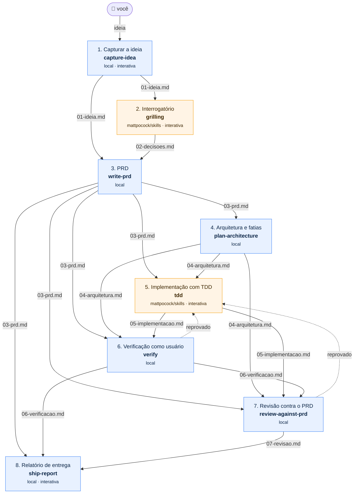

# O pipeline

Esta pasta é a **base**: o pipeline inteiro. Uma ideia solta entra, passa por oito etapas e sai como feature implementada com testes, **verificada como um usuário usaria**, revisada e documentada. Cada etapa é uma [Agent Skill](https://www.skills.sh/docs): umas escritas aqui, outras instaladas do [skills.sh](https://www.skills.sh/).

O objetivo é deixar **visível** como várias skills trabalham juntas:

- **qual** skill roda em cada etapa → [`flow.yaml`](flow.yaml)
- **o que** cada uma recebeu e entregou → os artefatos em `docs/flow/` (na raiz do repositório)
- **em que ponto** você está → `npm --prefix pipeline run status`
- **se o fluxo está consistente** → `npm --prefix pipeline run validate`
- **se ninguém mexeu no pipeline no meio do caminho** → `npm --prefix pipeline run guard`

E foi feito para você **não virar o gargalo**: o agente verifica o próprio trabalho, o que importa é garantido por script (não por prompt), e cada coisa que você precisou fazer à mão vira uma regra nova. Veja [Confiar nos agentes](guias/confiar-nos-agentes.md).

Funciona com **Claude Code**, **Codex** e qualquer agente compatível com o padrão Agent Skills. No ChatGPT e no Claude.ai web também dá para usar, de forma manual ([veja como](guias/usar-com-claude-e-chatgpt.md)).

## Base e produto

| | Base | Produto |
|---|---|---|
| O que é | o pipeline: skills, scripts, testes, regras, guias | o que uma execução gera |
| Onde fica | esta pasta `pipeline/` + o bloco do pipeline no `AGENTS.md`/`CLAUDE.md` da raiz | `docs/flow/` (artefatos), `docs/runs/` (execuções arquivadas) e a pasta `code` do `flow.yaml` (o código) |
| Vai para outro repositório? | sim, inteira | não |

A separação é garantida por script, não por instrução:

- `validate` falha se uma etapa gravar fora de `docs/flow/`, se um adapter ficar fora de `pipeline/` ou se `code` apontar para dentro de `pipeline/` ou de `docs/`;
- `guard` falha se algo da base mudar durante uma execução;
- os scripts acham a raiz do repositório pela própria localização, então rodam de qualquer pasta.

O código do projeto fica na pasta `code` do [`flow.yaml`](flow.yaml): `workspace` num projeto novo (o `archive` a guarda junto com a execução) ou `.` num projeto que já existia (o código do próprio repositório, que o `archive` não move). As skills leem esse valor no `status -- --json`.

## O fluxo

<!-- pipeline:diagram:start -->

<!-- pipeline:diagram:end -->

Azul = skill escrita aqui (`skills/`). Laranja = skill externa do skills.sh, encaixada com um *adapter* (`adapters/`). Setas cheias são **arquivos**: as skills nunca conversam entre si, só leem o que a etapa anterior gravou. Setas tracejadas são a volta quando uma etapa reprova.

| # | Etapa | Skill | Origem | Lê | Grava |
|---|-------|-------|--------|----|-------|
| 1 | Capturar a ideia | `capture-idea` | local | sua mensagem | `01-ideia.md` |
| 2 | Interrogatório | `grilling` | [mattpocock/skills](https://www.skills.sh/mattpocock/skills/grilling) | 01 | `02-decisoes.md` |
| 3 | PRD | `write-prd` | local | 01, 02 | `03-prd.md` |
| 4 | Arquitetura e fatias | `plan-architecture` | local | 03 | `04-arquitetura.md` |
| 5 | Implementação com TDD | `tdd` | [mattpocock/skills](https://www.skills.sh/mattpocock/skills/tdd) | 03, 04 | `05-implementacao.md` (com o mapa de funcionalidades) + o código, na pasta `code` |
| 6 | Verificação como usuário | `verify` | local | 03, 04, 05 | `06-verificacao.md` (provas e como repetir) |
| 7 | Revisão contra o PRD | `review-against-prd` | local | 03, 04, 05, 06 | `07-revisao.md` |
| 8 | Relatório de entrega | `ship-report` | local | 03, 06, 07 | `08-entrega.md` |

Acima de todas está o **maestro**, `run-pipeline`: uma skill que não faz o trabalho de nenhuma etapa. Ela pergunta ao `status` qual etapa vem agora, chama a skill certa, confere se o artefato apareceu e roda o `guard`. Se a verificação ou a revisão reprovar, ela volta para a implementação com as falhas já escritas. Isso não depende do maestro lembrar: o `status` lê o veredito (`on_reject` no `flow.yaml`), trava as etapas seguintes e diz qual refazer; e uma etapa cujo artefato não segue o contrato (cabeçalho errado ou sem veredito) não conta como pronta.

Ao lado do fluxo ficam as **skills de apoio** (`helpers` no `flow.yaml`), que não são etapas:

| Skill | Para quê |
|-------|----------|
| `investigate` | algo falhou: reproduz e lê o código antes de afirmar a causa |
| `harden` | transforma o "Trabalho manual" das entregas em regras duras, registradas em `endurecimento.md` |
| `eval-skill` | testa uma skill com os casos de [`evals/`](evals/README.md), num agente sem contexto, e dá nota |
| `onboard` | uma vez, num projeto que já existia: escreve o `docs/FEATURE-MAP.md` do código e procura skills para a stack com a `find-skills` |

## Começando

Requisitos: Node **22.18+**. Os scripts são TypeScript rodando direto no Node, sem build. Todos os comandos rodam de qualquer pasta do repositório.

```bash
npm --prefix pipeline install
```

```bash
npm --prefix pipeline run setup
```

O `setup` usa o CLI oficial do skills.sh (`npx skills add`) para instalar as skills externas do [`skills.json`](skills.json) e as locais de `skills/` em `.claude/skills/` (Claude Code) e `.agents/skills/` (Codex, Gemini CLI e outros), na raiz do repositório, onde os agentes procuram. Também liga o hook de pre-commit de `githooks/`.

```bash
npm --prefix pipeline run validate
```

Depois abra o agente na raiz do repositório e diga:

> Rode o pipeline. Minha ideia: um comando que conta as palavras de um texto e mostra as mais repetidas.

O agente vai rodar **uma etapa por vez** e parar entre elas para você ler o arquivo gerado. As etapas 1, 2, 5 e 8 são interativas: ele vai te fazer perguntas. A qualquer momento:

```bash
npm --prefix pipeline run status
```

```
ideia-ate-feature

  ✔ idea          capture-idea        pronta            docs/flow/01-ideia.md
  ✔ grill         grilling            pronta            docs/flow/02-decisoes.md
  ▶ prd           write-prd           pode rodar        vai gravar docs/flow/03-prd.md ← próxima
  · architecture  plan-architecture   bloqueada         falta docs/flow/03-prd.md
  ...
```

Quando terminar, `npm --prefix pipeline run archive` move os produtos da execução para `docs/runs/<data>-<ideia>/` e libera `docs/flow/` para a próxima ideia.

## Comandos

| Comando | O que faz |
|---------|-----------|
| `npm --prefix pipeline run setup` | Instala skills externas + locais para os agentes do `skills.json` (`-- --dry-run` só mostra os comandos) |
| `npm --prefix pipeline run validate` | Confere se o fluxo fecha: skills existem, entradas vêm de etapas anteriores, cada arquivo tem um dono, base e produto separados, instalação em dia |
| `npm --prefix pipeline run status` | Em que etapa você está (`-- --json` para agentes, `-- --dir <pasta>` para uma execução arquivada em `docs/runs/`) |
| `npm --prefix pipeline run new-skill -- <nome> "<descrição>"` | Cria `skills/<nome>/SKILL.md` no formato do pipeline |
| `npm --prefix pipeline run diagram -- --write` | Regenera o diagrama deste README a partir do `flow.yaml` |
| `npm --prefix pipeline run archive` | Move os produtos da execução atual para `docs/runs/` |
| `npm --prefix pipeline run guard` | Falha se a base (`pipeline/`, `AGENTS.md`, `CLAUDE.md`) mudou durante uma execução sem você aprovar (`git add`) |
| `npm --prefix pipeline run check` | Typecheck + testes + validate + guard (o pre-commit roda isto) |
| `npm --prefix pipeline run adopt -- <pasta> [--update] [--code <pasta>] [--dry-run] [--skip-install]` | Leva a base para outro projeto (ou a atualiza lá) e instala tudo; depois, a skill `onboard` ([guia](guias/montar-seu-fluxo.md#levar-o-pipeline-para-outro-repositório)) |

## Estrutura

```
pipeline/
├── flow.yaml                  # O FLUXO: ordem, skill, entradas e saídas de cada etapa, skills de apoio e a pasta do código
├── skills.json                # skills externas (owner/repo do skills.sh) + agentes alvo
├── skills-lock.json           # gerado pelo setup: versões exatas instaladas
├── skills/                    # skills escritas aqui (padrão Agent Skills)
│   ├── run-pipeline/          #   o maestro
│   │   ├── SKILL.md
│   │   └── references/contrato-dos-artefatos.md
│   ├── capture-idea/          #   cada etapa: SKILL.md + template.md do artefato
│   ├── write-prd/
│   ├── plan-architecture/
│   ├── verify/
│   ├── review-against-prd/
│   ├── ship-report/
│   ├── investigate/           #   skills de apoio (helpers)
│   ├── harden/
│   ├── eval-skill/
│   └── onboard/               #   + template.md do docs/FEATURE-MAP.md de um projeto que já existia
├── adapters/                  # encaixe das skills externas no fluxo
├── evals/                     # casos de teste das skills (eval-skill)
├── guias/                     # documentação detalhada
├── githooks/pre-commit        # roda o check antes de cada commit (ligado pelo setup)
├── scripts/                   # validate, status, setup, new-skill, diagram, archive, guard, adopt
│   └── lib/                   # lógica pura (testada em test/)
├── test/
├── FEATURE-MAP.md             # mapa da base: cada comando e skill, o código e o teste
├── endurecimento.md           # (criado pela harden) cada lição e a regra que a fecha
└── package.json, tsconfig.json
```

## Guias

1. [Como o fluxo funciona](guias/como-funciona.md): skills, artefatos, estados, o maestro e os adapters
2. [Adicionar uma skill](guias/adicionar-skills.md): do skills.sh ou escrita por você
3. [Montar o seu próprio fluxo](guias/montar-seu-fluxo.md): trocar, reordenar e criar etapas, ou levar o pipeline para outro repositório
4. [Usar com Claude e ChatGPT](guias/usar-com-claude-e-chatgpt.md): Claude Code, Claude.ai, Codex e ChatGPT web
5. [Confiar nos agentes](guias/confiar-nos-agentes.md): verificação, mapa de funcionalidades, regras duras, `harden` e evals, para você não virar o gargalo

## Sobre as skills externas

As skills de terceiros rodam com as mesmas permissões do seu agente. Leia o `SKILL.md` de cada uma antes de adicioná-la ao `skills.json` (o skills.sh tem uma página de [auditorias de segurança](https://www.skills.sh/audits)). O `setup` desliga a telemetria do CLI por padrão; use `DISABLE_TELEMETRY=0 npm --prefix pipeline run setup` se quiser contar no ranking do skills.sh.
